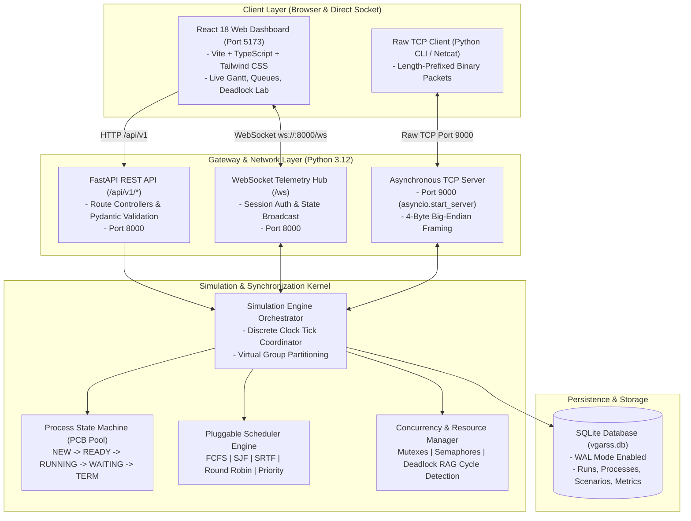
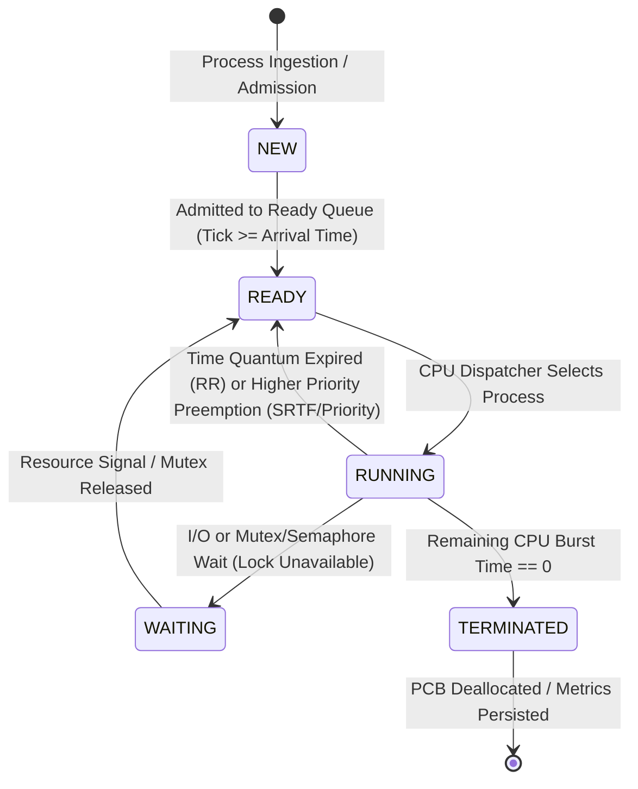

# VGARSS — System Architecture & Technical Specification

**System Name**: Virtual Group Asynchronous Real-Time Resource Synchronization & Scheduling System (VGARSS)  
**Document Version**: 2.0.0  
**Target Environment**: Windows 11 (64-bit), Python 3.12, Node.js 22 LTS, Vite, React 18, Tailwind CSS  
**Authors**: Principal Architect & Systems Engineering Team  

---

## 1. Executive Summary & Engineering Goals

VGARSS is a dual-domain systems engineering platform that synthesizes **Operating Systems (OS)** kernel simulation and **Computer Networks (CN)** asynchronous protocol architecture.

The core objectives are:
1. **Deterministic OS Process Lifecycle Simulation**: Explicitly model a 5-state process machine (`NEW`, `READY`, `RUNNING`, `WAITING`, `TERMINATED`) with Process Control Blocks (PCBs) and accurate mathematical metrics (Turnaround, Waiting, Response, Throughput, and CPU Utilization).
2. **Deterministic & Preemptive CPU Schedulers**: Pluggable strategies implementing First-Come, First-Served (**FCFS**), Shortest Job First (**SJF** non-preemptive), Shortest Remaining Time First (**SRTF** preemptive), **Round Robin** (with configurable time quantum and context-switch tracking), and **Priority Scheduling** (with starvation mitigation / aging).
3. **Concurrency Control & Deadlock Management**: Mutex locks, Counting Semaphores, and a live Resource Allocation Graph (RAG) with cycle detection (Tarjan/Kahn) and Banker's Algorithm safety verification.
4. **Multi-Protocol Asynchronous Networking**:
   - **REST APIs** for configuration, batch loading, and historical queries.
   - **Authenticated Bi-directional WebSockets** for low-latency live telemetry streams.
   - **Standalone Raw TCP Socket Server** running on port 9000 featuring a 4-byte big-endian length-prefix binary framing protocol to demonstrate low-level network packet handling and socket lifecycle.
5. **High-Density Infrastructure UI**: Dark developer-tool console built with React 18, TypeScript, and Tailwind CSS.

---

## 2. Component Architecture Diagram

The system comprises three primary tiers: Presentation (React Web Client), Application & Network Gateway (FastAPI ASGI + Raw TCP Socket Server), and Core Simulation Kernel (OS State Machine & Resource Coordinator).



---

## 3. Frontend Architecture & Route Tree

The frontend is structured as a Single-Page Application (SPA) with a responsive sidebar, persistent system status topbar, and dedicated views.

### 3.1 Route Specification

| Route Path | View Component | Description |
| :--- | :--- | :--- |
| `/` | `OverviewView` | System health, active virtual groups, global KPIs, and quick-action toolbar. |
| `/groups` | `VirtualGroupsView` | Partition management for collaborative or isolated simulation domains. |
| `/scheduler` | `ProcessSchedulerView` | Live Gantt chart, interactive Ready Queue, PCB inspection, and algorithm selector. |
| `/resources` | `ResourceMonitorView` | Mutex locks, semaphore capacity bars, and critical section allocation matrix. |
| `/deadlock` | `DeadlockLabView` | Visual Resource Allocation Graph (RAG), cycle detection alerts, and recovery actions. |
| `/network` | `NetworkMonitorView` | Live telemetry inspector, TCP port 9000 hex/JSON packet feed, and WebSocket stats. |
| `/analytics` | `PerformanceAnalyticsView` | Comparative metric curves, throughput graphs, and algorithm benchmarking tables. |
| `/settings` | `SettingsView` | Host port configuration, tick speed presets, log levels, and database export. |

### 3.2 State Management & Hook Conventions

```
frontend/src/
├── hooks/
│   ├── useSimulation.ts       # Central hook for play, pause, step, reset, and tick speed
│   ├── useWebSocket.ts        # Resilient WebSocket hook with heartbeat, backoff & buffer
│   ├── useTcpTelemetry.ts     # Stream listener for raw TCP socket packets
│   └── useVirtualGroups.ts    # Partition selection and isolation controls
├── stores/
│   └── simulationStore.ts     # Lightweight reactive state store (Zustand or Context + Reducer)
└── types/
    ├── process.ts             # PCB, ProcessState, and Priority types
    ├── scheduling.ts          # SchedulerType, Quantum, ContextSwitch, Metrics
    ├── resource.ts            # Mutex, Semaphore, ResourceAllocationGraph
    └── network.ts             # WebSocketEvent, TcpFrame, ConnectionStatus
```

---

## 4. Database Schema & Persistence (SQLite / PostgreSQL Path)

SQLite is utilized in WAL mode (`journal_mode=WAL`) for concurrent reading and writing without blocking the simulation engine. Schema structure is fully compatible with PostgreSQL.

### 4.1 Relational Schema Definitions

```sql
-- Virtual Groups (Isolated Simulation Contexts)
CREATE TABLE virtual_groups (
    id TEXT PRIMARY KEY,
    name TEXT NOT NULL,
    description TEXT,
    max_processes INTEGER DEFAULT 50,
    created_at TIMESTAMP DEFAULT CURRENT_TIMESTAMP,
    updated_at TIMESTAMP DEFAULT CURRENT_TIMESTAMP
);

-- Simulation Runs
CREATE TABLE simulation_runs (
    id TEXT PRIMARY KEY,
    group_id TEXT NOT NULL REFERENCES virtual_groups(id) ON DELETE CASCADE,
    algorithm TEXT NOT NULL,             -- 'FCFS', 'SJF', 'SRTF', 'ROUND_ROBIN', 'PRIORITY'
    time_quantum INTEGER DEFAULT 2,     -- For Round Robin
    context_switch_penalty INTEGER DEFAULT 0,
    status TEXT NOT NULL,                -- 'INITIALIZED', 'RUNNING', 'PAUSED', 'COMPLETED'
    total_ticks INTEGER DEFAULT 0,
    cpu_utilization REAL DEFAULT 0.0,
    avg_waiting_time REAL DEFAULT 0.0,
    avg_turnaround_time REAL DEFAULT 0.0,
    avg_response_time REAL DEFAULT 0.0,
    throughput REAL DEFAULT 0.0,
    created_at TIMESTAMP DEFAULT CURRENT_TIMESTAMP,
    completed_at TIMESTAMP
);

-- Processes (Process Control Blocks)
CREATE TABLE processes (
    id TEXT NOT NULL,                    -- e.g. 'P1', 'P2'
    run_id TEXT NOT NULL REFERENCES simulation_runs(id) ON DELETE CASCADE,
    state TEXT NOT NULL,                 -- 'NEW', 'READY', 'RUNNING', 'WAITING', 'TERMINATED'
    arrival_time INTEGER NOT NULL,
    burst_time INTEGER NOT NULL,
    remaining_time INTEGER NOT NULL,
    priority INTEGER DEFAULT 1,
    start_time INTEGER,                  -- First tick dispatched to CPU
    completion_time INTEGER,             -- Final tick execution finished
    waiting_time INTEGER DEFAULT 0,
    turnaround_time INTEGER DEFAULT 0,
    response_time INTEGER DEFAULT 0,
    created_at TIMESTAMP DEFAULT CURRENT_TIMESTAMP,
    PRIMARY KEY (id, run_id)
);

-- Shared Resources
CREATE TABLE resources (
    id TEXT PRIMARY KEY,
    run_id TEXT NOT NULL REFERENCES simulation_runs(id) ON DELETE CASCADE,
    name TEXT NOT NULL,
    type TEXT NOT NULL,                  -- 'MUTEX' or 'SEMAPHORE'
    total_instances INTEGER DEFAULT 1,
    available_instances INTEGER DEFAULT 1,
    current_holder_process_id TEXT
);

-- Simulation Gantt Ticks & Telemetry Logs
CREATE TABLE simulation_timeline (
    id INTEGER PRIMARY KEY AUTOINCREMENT,
    run_id TEXT NOT NULL REFERENCES simulation_runs(id) ON DELETE CASCADE,
    tick INTEGER NOT NULL,
    running_process_id TEXT,
    ready_queue_snapshot TEXT NOT NULL,  -- JSON Array of process IDs
    waiting_queue_snapshot TEXT NOT NULL,-- JSON Array of process IDs
    event_description TEXT,
    created_at TIMESTAMP DEFAULT CURRENT_TIMESTAMP
);
```

---

## 5. Process Lifecycle & 5-State Transition Engine

The simulation engine strictly enforces the standard 5-State Operating System process model:



### 5.1 Formal Transition Conditions

| Transition | Source State | Target State | Trigger Condition / Invariant |
| :--- | :--- | :--- | :--- |
| **Admit** | `NEW` | `READY` | Current simulation tick $\ge$ `arrival_time`. Process moves to Ready Queue. |
| **Dispatch**| `READY` | `RUNNING` | CPU is idle and scheduler selects process according to policy criteria. If `start_time` is null, set `start_time = current_tick`. |
| **Preempt** | `RUNNING` | `READY` | In Round Robin: process executed for `time_quantum` ticks without completing. In SRTF/Priority: new process with smaller remaining burst / higher priority arrives. Process returns to back of Ready Queue (or reinserted in order). |
| **Block** | `RUNNING` | `WAITING` | Process requests a Mutex currently held by another process, or requests a Semaphore with 0 available tokens. |
| **Unblock** | `WAITING` | `READY` | Holding process releases Mutex, or signals Semaphore; waiting process is selected (FIFO or priority) and restored to `READY`. |
| **Exit** | `RUNNING` | `TERMINATED`| `remaining_time` decrements to 0. Set `completion_time = current_tick`. Release all held locks. Compute turnaround and waiting times. |

---

## 6. CPU Scheduling Strategy Interfaces & Mathematical Specs

### 6.1 Abstract Base Scheduler Interface (Python)

```python
from abc import ABC, abstractmethod
from typing import List, Optional
from backend.app.schemas.process import ProcessControlBlock

class BaseScheduler(ABC):
    def __init__(self, name: str, is_preemptive: bool):
        self.name = name
        self.is_preemptive = is_preemptive

    @abstractmethod
    def select_next(
        self,
        ready_queue: List[ProcessControlBlock],
        current_running: Optional[ProcessControlBlock],
        current_tick: int
    ) -> Optional[ProcessControlBlock]:
        """Selects the next process to execute on the CPU for the upcoming tick."""
        pass

    @abstractmethod
    def should_preempt(
        self,
        running: ProcessControlBlock,
        ready_queue: List[ProcessControlBlock],
        current_quantum_ticks: int
    ) -> bool:
        """Determines if the currently running process must yield the CPU."""
        pass
```

### 6.2 Deterministic Scheduling Rules

1. **First-Come, First-Served (FCFS)**:
   - Non-preemptive. `select_next`: Sorts `ready_queue` by `arrival_time` ascending. Tie-breaker: `id` alphanumeric ascending. `should_preempt`: Always `False`.
2. **Shortest Job First (SJF - Non-Preemptive)**:
   - Non-preemptive. `select_next`: Selects process with minimum `burst_time`. Tie-breaker: `arrival_time` ascending, then `id`.
3. **Shortest Remaining Time First (SRTF - Preemptive SJF)**:
   - Preemptive. `select_next`: Selects process with minimum `remaining_time`.
   - `should_preempt`: Returns `True` if any process in `ready_queue` has `remaining_time < running.remaining_time`.
4. **Round Robin (RR)**:
   - Preemptive with time quantum $Q \ge 1$.
   - `select_next`: FIFO queue order.
   - `should_preempt`: Returns `True` when `current_quantum_ticks >= Q`. Preempted process is appended to the tail of `ready_queue`.
   - Context Switch: Optional configurable penalty $\delta \ge 0$ during which CPU is marked `IDLE_SWITCH`.
5. **Priority Scheduling**:
   - Supports both preemptive and non-preemptive modes. Convention: Lower numeric value = higher priority.
   - **Starvation Mitigation (Aging)**: For every $W$ ticks a process resides in `READY`, its priority is incremented by 1 until dispatched.

### 6.3 Mathematical Metrics Specifications

$$\text{Turnaround Time } (TAT) = T_{\text{completion}} - T_{\text{arrival}}$$

$$\text{Waiting Time } (WT) = TAT - T_{\text{burst}}$$

$$\text{Response Time } (RT) = T_{\text{first\_dispatch}} - T_{\text{arrival}}$$

$$\text{CPU Utilization } (\%) = \left( \frac{\sum T_{\text{busy\_ticks}}}{T_{\text{total\_ticks}}} \right) \times 100\%$$

$$\text{Throughput} = \frac{N_{\text{terminated\_processes}}}{T_{\text{total\_ticks}}}$$

---

## 7. Concurrency, Shared Resources & Deadlock Management

### 7.1 Synchronization Primitives

1. **Virtual Mutex**:
   - State: `is_locked: bool`, `owner_id: Optional[str]`, `wait_queue: List[str]`.
   - `acquire(process_id)`: If unlocked, set `owner_id = process_id` and return `True`. If locked, append `process_id` to `wait_queue` and transition process to `WAITING`.
   - `release(process_id)`: Validates `process_id == owner_id`. If `wait_queue` not empty, pop next process, transfer ownership, and transition process to `READY`. Otherwise set `is_locked = False`.
2. **Counting Semaphore**:
   - State: `capacity: int`, `available: int`, `wait_queue: List[str]`.
   - `wait(process_id)`: If `available > 0`, decrement `available -= 1`. Else, append to `wait_queue` and transition process to `WAITING`.
   - `signal()`: If `wait_queue` not empty, pop process and transition to `READY`. Else, increment `available += 1`.

### 7.2 Deadlock Detection (Resource Allocation Graph)

The system maintains a directed bipartite graph $G = (V, E)$ where $V = P \cup R$:
- **Request Edge**: $P_i \to R_j \iff P_i \text{ is waiting to acquire } R_j$.
- **Assignment Edge**: $R_j \to P_i \iff R_j \text{ is currently allocated to } P_i$.

**Cycle Detection Algorithm**:
At every resource request tick, Tarjan's strongly connected components algorithm or Kahn's topological sort is executed on the wait-for graph:
1. If a directed cycle is identified (e.g. $P_1 \to R_1 \to P_2 \to R_2 \to P_1$), emit a `DEADLOCK_DETECTED` event.
2. Highlight cyclic vertices in the UI Deadlock Laboratory.
3. Provide manual and automated recovery triggers:
   - **Abort Process**: Terminate lowest-priority process in cycle and release held resources.
   - **Preempt Resource**: Forcefully revoke resource lock from holder and roll process back to `READY`.

---

## 8. REST API Contracts & Schema Specification

All REST endpoints reside under the `/api/v1` namespace.

### 8.1 System & Virtual Groups

#### `GET /api/v1/health`
- **Response 200 OK**:
  ```json
  {
    "status": "healthy",
    "version": "1.0.0",
    "timestamp": "2026-10-28T23:00:00Z",
    "ports": { "rest_api": 8000, "websocket": 8000, "raw_tcp": 9000 }
  }
  ```

#### `GET /api/v1/groups`
- **Response 200 OK**:
  ```json
  [
    {
      "id": "group-alpha",
      "name": "Production Simulation Cluster",
      "description": "Primary scheduling environment",
      "active_runs": 1,
      "created_at": "2026-10-28T22:00:00Z"
    }
  ]
  ```

### 8.2 Simulation Lifecycle & Control

#### `POST /api/v1/simulation/create`
- **Request Body**:
  ```json
  {
    "group_id": "group-alpha",
    "algorithm": "ROUND_ROBIN",
    "time_quantum": 2,
    "context_switch_penalty": 0,
    "processes": [
      { "id": "P1", "arrival_time": 0, "burst_time": 6, "priority": 2 },
      { "id": "P2", "arrival_time": 1, "burst_time": 4, "priority": 1 },
      { "id": "P3", "arrival_time": 2, "burst_time": 8, "priority": 3 }
    ],
    "resources": [
      { "name": "MUTEX_A", "type": "MUTEX", "instances": 1 },
      { "name": "SEM_B", "type": "SEMAPHORE", "instances": 2 }
    ]
  }
  ```
- **Response 201 Created**:
  ```json
  {
    "run_id": "sim-run-9182",
    "status": "INITIALIZED",
    "algorithm": "ROUND_ROBIN",
    "total_processes": 3
  }
  ```

#### `POST /api/v1/simulation/{run_id}/step`
- Advances simulation by exactly 1 tick.
- **Response 200 OK**: Returns updated state snapshot.

#### `POST /api/v1/simulation/{run_id}/play`
- Starts continuous execution at configured speed.

#### `POST /api/v1/simulation/{run_id}/pause`
- Suspends continuous execution.

#### `POST /api/v1/simulation/{run_id}/reset`
- Clears queues, resets clocks to 0, and restores initial PCB values.

---

## 9. Real-Time Telemetry & Raw Socket Protocols

### 9.1 Authenticated WebSocket Protocol (`/ws`)

1. **Handshake & Authentication**:
   - Connection URI: `ws://127.0.0.1:8000/ws?token=<session_token>`
   - Alternatively, client sends immediate authentication frame:
     ```json
     { "type": "AUTH", "payload": { "token": "vgarss-dev-token" } }
     ```
2. **Telemetry Broadcast Frame (`STATE_UPDATE`)**:
   Sent by server on every tick:
   ```json
   {
     "type": "STATE_UPDATE",
     "run_id": "sim-run-9182",
     "tick": 7,
     "cpu": {
       "state": "BUSY",
       "running_process_id": "P2",
       "remaining_burst": 2,
       "current_quantum_tick": 1
     },
     "queues": {
       "ready": ["P1", "P3"],
       "waiting": [],
       "terminated": []
     },
     "resources": [
       { "id": "MUTEX_A", "type": "MUTEX", "is_locked": true, "owner": "P2", "waiters": [] },
       { "id": "SEM_B", "type": "SEMAPHORE", "available": 1, "capacity": 2, "waiters": [] }
     ],
     "deadlock": {
       "detected": false,
       "cycle_nodes": []
     },
     "metrics": {
       "cpu_utilization": 85.7,
       "avg_waiting_time": 2.33,
       "avg_turnaround_time": 5.67,
       "throughput": 0.0
     }
   }
   ```

### 9.2 Raw TCP Socket Protocol (Port 9000)

Dedicated TCP socket server implemented with Python `asyncio` to demonstrate computer networking packet framing and serialization:

#### Framing Specification
```
 0                   1                   2                   3
 0 1 2 3 4 5 6 7 8 9 0 1 2 3 4 5 6 7 8 9 0 1 2 3 4 5 6 7 8 9 0 1
+-+-+-+-+-+-+-+-+-+-+-+-+-+-+-+-+-+-+-+-+-+-+-+-+-+-+-+-+-+-+-+-+
|                 Payload Length N (4 Bytes Big-Endian)         |
+-+-+-+-+-+-+-+-+-+-+-+-+-+-+-+-+-+-+-+-+-+-+-+-+-+-+-+-+-+-+-+-+
|                                                               |
+                   UTF-8 JSON Encoded Payload                  +
|                          (N Bytes)                            |
+-+-+-+-+-+-+-+-+-+-+-+-+-+-+-+-+-+-+-+-+-+-+-+-+-+-+-+-+-+-+-+-+
```

#### Supported TCP Actions
- `SUBMIT_PROCESS`: Dynamically inject a process into the simulation.
- `QUERY_STATUS`: Request immediate binary state snapshot.
- `ACQUIRE_RESOURCE`: External TCP client process requests a simulation lock.
- `RELEASE_RESOURCE`: External TCP client process releases a held lock.

---

## 10. Authorization, Security & Error Handling

1. **Authorization**:
   - Development session tokens (`vgarss-dev-token`) validated on WebSocket connect and restricted REST endpoints.
   - CORS middleware restricted to `http://localhost:5173` and `http://127.0.0.1:5173`.
2. **Error Handling Architecture**:
   Standardized JSON error envelope:
   ```json
   {
     "error": {
       "code": "INVALID_BURST_TIME",
       "message": "Process burst time must be an integer greater than 0.",
       "details": { "provided": -3, "field": "burst_time" },
       "timestamp": "2026-10-28T23:05:00Z"
     }
   }
   ```
3. **WebSocket Reconnection & Heartbeat**:
   - Client sends heartbeat ping every 15 seconds: `{"type": "PING"}`. Server replies: `{"type": "PONG"}`.
   - If connection drops, frontend initiates exponential backoff reconnect: $1s \to 2s \to 4s \to 8s \dots \text{max } 30s$.

---

## 11. Testing & Verification Architecture

1. **Unit Tests (`tests/backend/`)**:
   - `test_process_lifecycle.py`: Asserts strict state machine transitions.
   - `test_schedulers.py`: Verifies FCFS, SJF, SRTF, RR, Priority against mathematical Silberschatz reference benchmarks.
   - `test_synchronization.py`: Tests Mutex mutual exclusion and counting semaphore limits.
   - `test_deadlock.py`: Triggers circular wait conditions and asserts RAG cycle detection.
2. **Network & Framing Tests**:
   - `test_tcp_framing.py`: Asserts partial-buffer reads, framing chunking, and JSON reconstruction.
   - `test_websocket.py`: Validates WebSocket state broadcast and event routing.
3. **Frontend Build & Browser Tests**:
   - TypeScript compiler validation (`tsc -b`).
   - Vite bundle validation (`npm run build`).
   - Browser subagent interaction and recording.

---

## 12. Windows Deployment & Process Topology

- **FastAPI ASGI Server**: `uvicorn backend.app.main:app --host 127.0.0.1 --port 8000`
- **TCP Socket Server**: Coroutine within FastAPI lifespan on `127.0.0.1:9000`
- **Vite Web Dashboard**: `npx vite` on `http://localhost:5173`
- **Storage**: Local zero-setup SQLite database file `vgarss.db`
