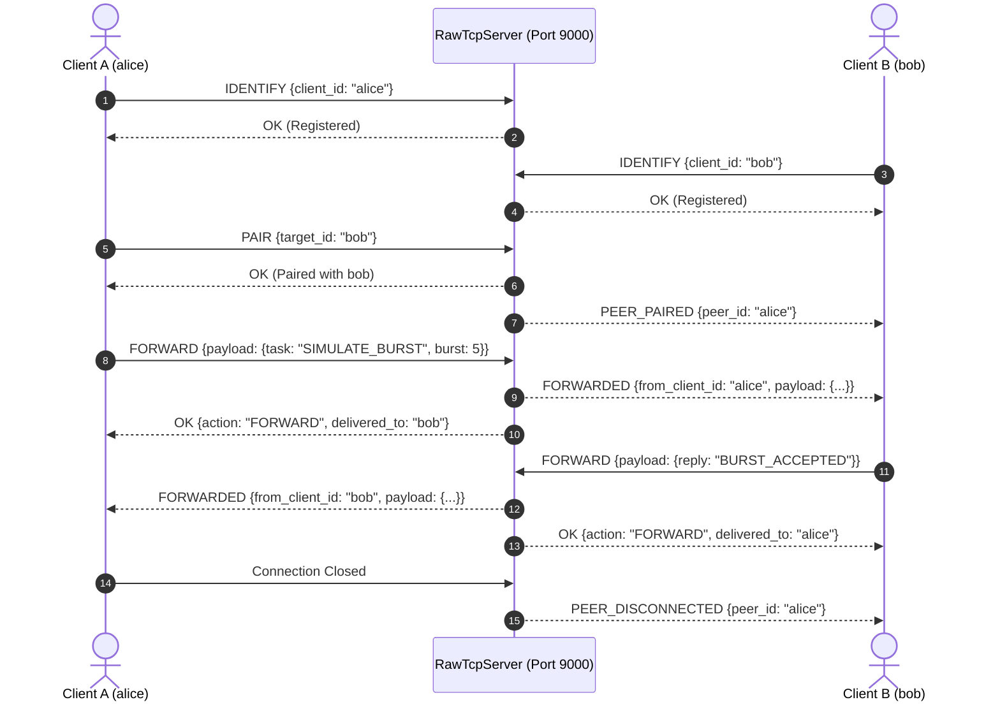

# VGARSS — Networking Architecture & Protocol Specification

**Document Version**: 2.0.0  
**Classification**: Engineering Systems Standard  
**System Target**: Windows 11 (64-bit), Python 3.12, Node.js 22 LTS  

---

## 1. System Topology & Private Local Service Matrix

VGARSS operates on a multi-protocol asynchronous network stack strictly bounded to the local loopback interface (`127.0.0.1`) to ensure developer environment isolation and privacy. No network listeners bind to open public interfaces (`0.0.0.0`) by default.

### 1.1 Port Allocation Matrix

| Port | Protocol / Transport | Component | Purpose | Access Control |
| :--- | :--- | :--- | :--- | :--- |
| **8000** | HTTP / REST (`/api/v1/*`) | FastAPI Gateway | Process definitions, simulation stepping, user sessions, resource allocations | Bearer Session Token (`Authorization: Bearer <token>`) |
| **8000** | WebSockets (`/ws/groups/{id}`) | Telemetry Hub | Low-latency bi-directional group telemetry, task lifecycle events, resync | Group RBAC Authorization & Session Token |
| **8000** | WebSockets (`/ws`) | Fallback Telemetry | Global system broadcast feed & heartbeat stream | Unauthenticated / Public Loopback |
| **9000** | Raw TCP Sockets | Standalone TCP Server | Low-level binary framing, paired-client forwarding, direct kernel packet emulation | Framed JSON Commands & Connection Caps |
| **5173** | HTTP / HMR | Vite Web Client | React 18 frontend dashboard and real-time inspector | Localhost CORS restricted (`http://127.0.0.1:5173`) |

---

## 2. Part A: Authenticated Group-Specific WebSockets

The WebSocket subsystem provides isolated, real-time telemetry streaming partitioned by **Virtual Group**. Subscribers receive discrete OS simulation events with deterministic monotonic sequence numbers.

### 2.1 Endpoint Specification

- **Primary Route**: `/ws/groups/{group_id}`
- **Fallback Route**: `/ws`

#### Handshake Authentication
Authentication can be established through two supported methods:
1. **Query Parameter**:
   ```
   ws://127.0.0.1:8000/ws/groups/{group_id}?token=<session_token>&last_seq=<optional_int>
   ```
2. **Initial Authentication Frame**:
   The client connects and transmits an initial JSON frame within a 5-second window:
   ```json
   {
     "type": "AUTH",
     "token": "dGhpcy1pcy1hLXRlc3Qtc2Vzc2lvbi10b2tlbg",
     "last_seq": 14
   }
   ```

#### Group Authorization Boundary
The backend validates that the session is active and that the authenticated user is either the **Owner** or an authorized **Member** (via `group_memberships`). Unauthorized or cross-group connection attempts receive a structured error frame and are closed immediately with `1008 Policy Violation`:
```json
{
  "type": "ERROR",
  "code": "FORBIDDEN",
  "message": "Unauthorized: invalid session token or no access to group 'grp-alpha'.",
  "timestamp": "2026-10-29T00:00:00Z"
}
```

### 2.2 Event Sequencing & Monotonicity
Each Virtual Group maintains an independent, strictly monotonic integer sequence counter starting at 1. Every event emitted within the group includes its sequence number:
```json
{
  "seq": 42,
  "type": "SIMULATION_STEP",
  "group_id": "grp-alpha-01",
  "simulation_id": "sim-8192",
  "timestamp": "2026-10-29T00:00:00.123456Z",
  "payload": {
    "simulation_id": "sim-8192",
    "tick": 7,
    "status": "RUNNING",
    "running_process_id": "P2",
    "ready_queue": ["P1", "P3"],
    "waiting_queue": [],
    "terminated_processes": [],
    "metrics": {
      "cpu_utilization": 85.7,
      "avg_waiting_time": 2.33,
      "avg_turnaround_time": 5.67,
      "throughput": 0.0
    },
    "gantt_entry": {
      "tick": 6,
      "process_id": "P2",
      "state": "RUNNING"
    }
  }
}
```

### 2.3 Event Taxonomy

| Event Type | Category | Description | Key Payload Fields |
| :--- | :--- | :--- | :--- |
| `AUTH_SUCCESS` | System | Successful handshake and group authorization | `group_id`, `current_seq`, `user` |
| `SIMULATION_CREATED` | Task Lifecycle | New simulation initialized | `name`, `algorithm`, `total_processes`, `total_resources` |
| `SIMULATION_STEP` | Task Lifecycle | Clock advanced by 1 tick | `tick`, `running_process_id`, `ready_queue`, `metrics`, `gantt_entry` |
| `SIMULATION_COMPLETED`| Task Lifecycle | All admitted processes terminated | `final_tick`, `metrics` |
| `RESOURCE_ACQUIRED` | Concurrency | Process successfully acquired lock/units | `process_id`, `resource_id`, `mode`, `units`, `granted: true` |
| `RESOURCE_BLOCKED` | Concurrency | Request blocked; process moved to `WAITING` | `process_id`, `resource_id`, `mode`, `units`, `granted: false` |
| `RESOURCE_RELEASED` | Concurrency | Lock released; waiting processes awakened | `process_id`, `resource_id`, `awakened_processes` |
| `DEADLOCK_DETECTED` | Concurrency | Cycle detected in Wait-For Graph | `cycle_processes`, `involved_resources`, `description` |
| `RESYNC_BATCH` | State Sync | Replay of missed events after brief disconnect | `from_seq`, `to_seq`, `missed_count`, `events` |
| `RESYNC_FULL` | State Sync | Full group snapshot after large gap or initial sync | `current_seq`, `simulations` snapshot list |
| `PONG` | Health | Heartbeat response to client ping | `client_timestamp`, `server_timestamp` |

### 2.4 State Resynchronization Protocol
Clients recovering from disconnections or packet drops specify `last_seq` (the highest sequence number successfully processed):
1. **Delta Batch Replay (`RESYNC_BATCH`)**:
   If the missing sequence range $[last\_seq + 1, current\_seq]$ is contained within the group's in-memory history ring buffer (default 500 events), the server transmits all missed events in exact order.
2. **Full Snapshot Fallback (`RESYNC_FULL`)**:
   If $last\_seq \le 0$ or the gap exceeds the history capacity, the server queries SQLite for active simulations and produces a comprehensive state snapshot, allowing deterministic client-side synchronization without missing intermediate metrics.

### 2.5 Slow-Client Protection & Queue Backpressure
To prevent a slow consumer (e.g. stalled browser thread or degraded network link) from inducing head-of-line blocking for other group subscribers:
- Each client connection maintains a private bounded outbound queue (`asyncio.Queue(maxsize=100)`).
- A dedicated background sender coroutine consumes from the queue with an explicit write timeout (`5.0s`).
- When an event is broadcast, `send_event_nowait` enqueues the payload. If the queue is at capacity (`QueueFull`), the client is flagged as a **Slow Client** and immediately evicted with `1008 Policy Violation`:
  ```
  [SlowClient] Outbound queue full (100) for user=alice group=grp-01. Dropping connection.
  ```
- Normal and fast clients continue receiving uninterrupted updates at full tick frequency.

---

## 3. Part B: Standalone Raw Python TCP Socket Server

The raw TCP server runs as a separate, decoupled Python subsystem (`backend/app/network/tcp_server.py`) on port **9000**. It has zero dependencies on FastAPI or HTTP transport layers.

### 3.1 Binary Length-Prefixed Framing Protocol

Every TCP packet consists of a **4-byte big-endian unsigned integer length header** followed by a UTF-8 JSON payload.

```
 0                   1                   2                   3
 0 1 2 3 4 5 6 7 8 9 0 1 2 3 4 5 6 7 8 9 0 1 2 3 4 5 6 7 8 9 0 1
+-+-+-+-+-+-+-+-+-+-+-+-+-+-+-+-+-+-+-+-+-+-+-+-+-+-+-+-+-+-+-+-+
|                 Payload Length N (4 Bytes Big-Endian)         |
+-+-+-+-+-+-+-+-+-+-+-+-+-+-+-+-+-+-+-+-+-+-+-+-+-+-+-+-+-+-+-+-+
|                                                               |
+                   UTF-8 JSON Encoded Payload                  +
|                          (N Bytes)                            |
+-+-+-+-+-+-+-+-+-+-+-+-+-+-+-+-+-+-+-+-+-+-+-+-+-+-+-+-+-+-+-+-+
```

- **Header Format**: `!I` (`struct.pack("!I", length)`)
- **Maximum Frame Size**: 1 MB (`1024 * 1024` bytes, configurable). Frames declaring length greater than this limit are rejected with `FRAME_TOO_LARGE` and the connection is closed.
- **Partial Read Resilience**: Streaming buffers utilize `asyncio.StreamReader.readexactly` to assemble fragmented TCP packets arriving byte-by-byte or across segment boundaries.

### 3.2 Bounded Concurrency & Limits
- **Connection Capacity**: Configurable maximum concurrent clients (`default: 50`).
- **Capacity Exceeded**: When active sockets reach `max_connections`, subsequent connection handshakes are sent an immediate rejection frame and closed cleanly:
  ```json
  {
    "status": "ERROR",
    "code": "CONCURRENCY_LIMIT_EXCEEDED",
    "message": "Server connection limit of 50 reached."
  }
  ```
- **Idle Client Timeout**: If a connected client emits no framed packet within `read_timeout` (default 30 seconds), the server transmits `TIMEOUT` and recycles socket resources.

### 3.3 TCP Command Catalog

| Action | Description | Sample Request | Sample Response |
| :--- | :--- | :--- | :--- |
| `PING` | Health check & latency calculation | `{"action": "PING"}` | `{"status": "OK", "action": "PONG", "timestamp": "..."}` |
| `ECHO` | Loopback validation | `{"action": "ECHO", "data": {"test": 1}}` | `{"status": "OK", "action": "ECHO", "data": {"test": 1}}` |
| `IDENTIFY`| Register custom client identifier | `{"action": "IDENTIFY", "client_id": "alice"}` | `{"status": "OK", "action": "IDENTIFY", "client_id": "alice"}` |
| `STATUS` | Query client pairing and peer info | `{"action": "STATUS"}` | `{"status": "OK", "action": "STATUS", "peer_id": "bob"}` |
| `PAIR` | Directly pair with another client ID | `{"action": "PAIR", "target_id": "bob"}` | `{"status": "OK", "action": "PAIR", "peer_id": "bob"}` |
| `JOIN_PAIR`| Join a paired room / channel | `{"action": "JOIN_PAIR", "room_id": "r1"}` | `{"status": "OK", "action": "JOIN_PAIR", "peer_id": "bob"}` |
| `FORWARD` | Route payload to paired peer | `{"action": "FORWARD", "payload": {...}}` | `{"status": "OK", "action": "FORWARD", "delivered_to": "bob"}` |
| `UNPAIR` | Terminate active pairing relationship| `{"action": "UNPAIR"}` | `{"status": "OK", "action": "UNPAIR"}` |

### 3.4 Paired-Client Forwarding Protocol
The raw TCP server demonstrates bidirectional peer-to-peer message routing across isolated socket connections:



---

## 4. Verification & Testing

Automated test suites comprehensively exercise concurrency, protocol framing, error states, and disconnections:

```powershell
# Run the entire test suite (52 tests)
.venv\Scripts\pytest

# Run raw TCP server tests (framing, partial reads, timeouts, paired forwarding)
.venv\Scripts\pytest tests/backend/test_tcp_server.py -v

# Run authenticated group WebSocket tests (auth, sequence numbers, resync, slow-client)
.venv\Scripts\pytest tests/backend/test_websocket_networking.py -v

# Validate frontend TypeScript build
npm --prefix frontend run build
```

